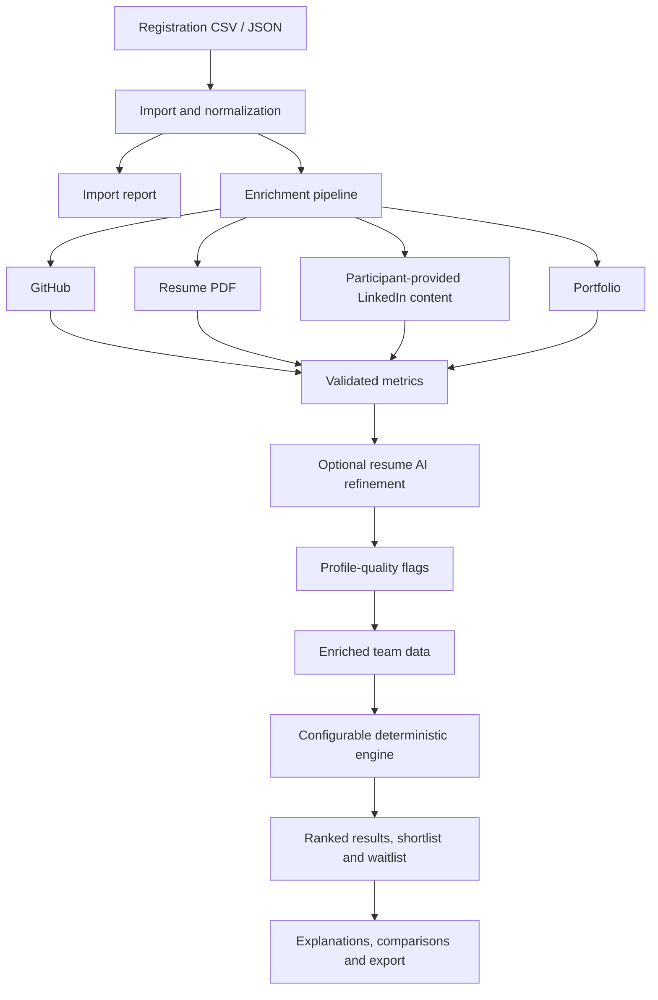

<div align="center">

# TeamLens
## Team Recruitment Automation Tool

**Evidence-driven shortlisting. Transparent scoring. Human-led decisions.**

A configurable tool for importing team registrations, enriching participant profiles, evaluating eligibility, and producing explainable shortlists — without using an LLM to score or rank candidates.

[Repository](https://github.com/dvprajapati5090/Incursion_2k26)

</div>

---

## Contents

- [Overview](#overview)
- [What Makes It Different](#what-makes-it-different)
- [Features](#features)
- [How the System Works](#how-the-system-works)
- [Architecture](#architecture)
- [Technology Stack](#technology-stack)
- [Getting Started](#getting-started)
- [Environment Configuration](#environment-configuration)
- [Using the Application](#using-the-application)
- [API Reference](#api-reference)
- [Input Data Format](#input-data-format)
- [Metric and Result Contracts](#metric-and-result-contracts)
- [Scoring and Explainability](#scoring-and-explainability)
- [Security, Privacy, and Responsible Use](#security-privacy-and-responsible-use)
- [Testing and Validation](#testing-and-validation)
- [Known Limitations](#known-limitations)
- [Repository Structure](#repository-structure)
- [Contributing](#contributing)

## Overview

Hackathon organisers often receive registrations in spreadsheets, while the evidence needed to review participants is spread across resumes, GitHub profiles, LinkedIn exports, and portfolio websites. Reviewing every profile manually can be slow, inconsistent, and difficult to audit.

**TeamLens — Team Recruitment Automation Tool** is designed to make that process more structured and reviewable.

The application brings together:

1. **Registration import** from CSV or JSON.
2. **Profile enrichment** from supported participant data sources.
3. **Configurable evaluation** using explicit criteria, weights, and eligibility rules.
4. **Explainable results** with score breakdowns and data-quality signals.
5. **Review and export workflows** to help organisers inspect and use shortlist results.

The project separates evidence collection from evaluation. The server gathers and validates data; the deterministic engine applies the organiser's configuration. Optional AI is used for structured extraction, not candidate ranking.

> **Core principle:** AI may help extract facts. It does not decide who gets shortlisted.

## What Makes It Different

| Common problem | How this project addresses it |
|---|---|
| Registrations arrive in inconsistent formats | CSV/JSON import, column mapping, normalization, and import reports |
| Missing information is mistaken for poor performance | Explicit metric statuses and configurable missing-data handling |
| AI extraction can be unreliable | Schema-validated extraction, quote verification, confidence tracking, and rule-based fallback |
| A ranking is hard to justify | Deterministic scoring, eligibility outcomes, and generated explanations |
| Suspicious profile patterns can be misinterpreted | Flags provide evidence for human review, not automatic proof of misconduct |
| Recruitment criteria vary between events | Configurable criteria, weights, filters, tie-breakers, and presets |
| Small changes may affect the shortlist | Sensitivity analysis helps examine shortlist stability under weight changes |

## Features

### Registration and enrichment

- Import registrations from CSV and JSON.
- Map incoming CSV headers to the canonical fields.
- Normalize member records into teams using `team_id`.
- Enrich supported data from GitHub, text-based PDF resumes, participant-provided LinkedIn text/PDFs, and portfolio pages.
- Report import issues and distinguish unavailable data from failed requests.
- Cache enrichment results to reduce repeat work.
- Track long-running enrichment jobs and expose progress through the API.

### Configurable evaluation

- Apply eligibility filters before scoring.
- Normalize and aggregate metric values into team-level criteria.
- Use relative criterion weights.
- Configure tie-breakers and shortlist size.
- Support manual pin, exclude, and waitlist overrides in the engine.
- Handle incomplete data according to the configured policy.
- Generate per-team explanations.
- Compare teams head-to-head.
- Analyze sensitivity to changes in criterion weights.
- Export shortlist results as JSON or CSV.
- Anonymize team/member information for blind review.

### Frontend workflow

The web application includes upload and column-mapping screens, data-quality and import reports, configuration controls, results tables, team detail/comparison views, and export workflows. It uses a client-side scoring implementation and a worker module for responsive ranking.

### Responsible AI and data quality

- AI extraction is optional.
- Extracted resume facts are checked against source quotes.
- Confidence and provenance are retained for supported extracted values.
- Rule-based parsing remains available as a fallback.
- Suspicious-profile findings are separate from ordinary metrics and should be reviewed by a person.

## How the System Works



**Pipeline at a glance**

1. **Import:** Read CSV or JSON, map columns, normalize records, and report issues.
2. **Enrich:** Collect supported GitHub, resume, LinkedIn, and portfolio information.
3. **Refine:** Optionally use AI to refine uncertain resume extraction; validate output and retain uncertainty.
4. **Flag:** Produce structured profile-quality signals for human review.
5. **Evaluate:** Apply eligibility filters, score eligible teams, rank results, and apply configured overrides.
6. **Review:** Inspect explanations, compare teams, analyze sensitivity, and export results.

The backend does not make recruitment decisions on its own. The scoring engine uses explicit configuration, and organisers remain responsible for reviewing evidence and making final decisions.

## Architecture

The repository is a monorepo with separate `web/`, `engine/`, and `server/` areas, plus shared samples and integration tests.

| Layer | Responsibility |
|---|---|
| `web/` | Browser UI, upload workflow, configuration, results, and client-side scoring |
| `engine/` | Scoring, filtering, ranking, explanations, presets, comparison, sensitivity, anonymization, and export |
| `server/` | Import/enrichment API, source fetchers, optional AI refinement, cache, background jobs, and metric registry |
| `shared-samples/` | Example input, enriched data, registry, config, and large synthetic dataset |
| `tests/` | Cross-module integration tests |

### Engine: deterministic evaluation

The engine is a JavaScript module exported from `engine/src/index.js`. Its `runEngine(teams, config, registry)` entry point validates configuration, applies eligibility filters, scores eligible teams, ranks them, and attaches explanations. Related exports provide presets, pairwise comparison, sensitivity analysis, shortlist export, and anonymization.

The engine does not fetch external profiles. It evaluates the data it receives, making its behavior easier to test and reproduce.

### Server: import and enrichment

The Express server handles import, normalization, enrichment, caching, background jobs, and the HTTP interface. Source-specific enrichers are separated by data source. The metric registry is exposed to consumers so that the available metric contract can be inspected.

### Web: organiser workflow

The React/Vite frontend provides the upload, configuration, results, and export pages. Its components include column mapping, import reporting, data-quality views, criteria/filter editors, result tables, team detail and comparison views, and preset management.

The web package also contains a worker module for client-side ranking and Vitest tests for frontend workflows and engine behavior.

## Technology Stack

| Technology | Use |
|---|---|
| JavaScript ES modules | Shared application language |
| React 19 + Vite | Frontend and development server |
| React Router | Frontend navigation |
| Zustand | Frontend state management |
| TanStack React Table | Tabular results |
| Recharts | Data visualization |
| PapaParse | CSV parsing |
| Express 5 | Backend API |
| Node.js | Backend runtime |
| SQLite cache | Persistent enrichment caching using Node's built-in SQLite support |
| GitHub GraphQL API | GitHub profile/repository metrics |
| Cheerio | HTML parsing for supported portfolio pages |
| `unpdf` | PDF text extraction |
| Zod | Runtime data/config validation |
| Gemini / Ollama providers | Optional AI-assisted resume extraction, according to server configuration |
| Vitest + Testing Library + Supertest | Unit, component, API, and integration testing |

## Getting Started

### Prerequisites

- Node.js **22.13 or newer** for the server's built-in SQLite support.
- npm.
- Git.
- Optional: a GitHub token for live GitHub data.
- Optional: an AI provider configuration for resume refinement.

### 1. Clone the repository

```bash
git clone https://github.com/dvprajapati5090/Incursion_2k26.git
cd Incursion_2k26
```

### 2. Install dependencies

The repository has separate packages. Install each package's dependencies in its directory:

```bash
cd engine
npm install

cd ../server
npm install

cd ../web
npm install

cd ../tests
npm install
```

### 3. Configure the backend

From `server/`, copy the example environment file:

```bash
# macOS / Linux
cp .env.example .env

# Windows Command Prompt
copy .env.example .env
```

Edit `server/.env` and set the values you need. API keys are optional for local development. Never commit `.env` or credentials.

### 4. Start the backend

From `server/`:

```bash
npm run dev
```

The default backend port is `4000`.

Check the health endpoint:

```bash
curl http://localhost:4000/api/health
```

### 5. Start the frontend

In a separate terminal:

```bash
cd web
npm install
npm run dev
```

Vite's default development URL is `http://localhost:5173`. If the backend is running on another origin, configure the frontend API URL as described below.

### 6. Build the frontend

From `web/`:

```bash
npm run build
npm run preview
```

### Local development checklist

- Start the server on port `4000`.
- Start the frontend on port `5173`.
- Keep the configured `CORS_ORIGIN` aligned with the frontend origin.
- Add a GitHub token only if live GitHub enrichment is required.
- Add AI provider credentials only if AI refinement is required.

## Environment Configuration

The authoritative list is `server/.env.example`.

| Variable | Purpose | Notes |
|---|---|---|
| `PORT` | Backend port | Defaults to `4000` in the example file |
| `NODE_ENV` | Runtime environment | Example uses `development` |
| `CORS_ORIGIN` | Allowed frontend origin(s) | Example uses `http://localhost:5173`; comma-separated origins are supported by the server config |
| `GITHUB_TOKEN` | GitHub API access | Optional; without it, the server can use mock GitHub data where implemented |
| `GITHUB_CACHE_TTL_HOURS` | GitHub cache lifetime | Example: `24` |
| `RESUME_CACHE_TTL_HOURS` | Resume cache lifetime | Example: `168` |
| `ENRICH_CONCURRENCY` | Enrichment concurrency limit | Example: `4` |
| `LLM_PROVIDER` | Select configured LLM provider | Optional |
| `GEMINI_API_KEY` | Gemini credentials | Optional |
| `GEMINI_MODEL` | Gemini model name | Example: `gemini-flash-lite-latest` |
| `LLM_MODE` | AI refinement mode | Example: `auto` |
| `LLM_MIN_INTERVAL_MS` | Minimum interval between LLM calls | Example: `4000` |
| `LLM_CONCURRENCY` | LLM concurrency limit | Example: `2` |
| `LLM_CACHE_TTL_HOURS` | LLM result cache lifetime | Example: `168` |
| `VITE_API_URL` | Frontend build-time backend origin | Used for production builds; set to the backend origin without `/api` |

Use the names and defaults in the current `.env.example` as the source of truth if they change.

## Using the Application

### 1. Prepare the registrations file

Use CSV or JSON. The canonical CSV format is one row per member, grouped by `team_id`. If your form export uses different headers, use the column-mapping workflow.

### 2. Import data

From the web UI, upload your file and review the import report. The backend API also supports direct CSV/JSON import.

### 3. Enrich participant information

Start enrichment and monitor the job's progress. Review missing sources, failed fetches, uncertain values, and profile flags rather than treating every blank field as a negative signal.

### 4. Configure evaluation

Choose the shortlist size, criteria, weights, filters, and relevant overrides. The engine validates the configuration against the metric registry before evaluation.

### 5. Review the results

Inspect the ranked teams, explanations, team details, data quality, and comparison views. Use sensitivity analysis to understand whether small weight changes substantially affect the shortlist.

### 6. Export results

Use the export workflow to produce shortlist data in the supported format. Retain the configuration used for a run when you need to reproduce or audit the decision later.

## API Reference

The following routes are implemented in `server/src/routes/`. All paths below are relative to the backend origin, normally `http://localhost:4000`.

### Health and registry

| Method | Endpoint | Purpose |
|---|---|---|
| `GET` | `/api/health` | Health status, uptime, and server time |
| `GET` | `/api/registry` | Return the metric registry |

### Imports and enrichment

| Method | Endpoint | Purpose |
|---|---|---|
| `POST` | `/api/imports` | Import CSV or JSON as multipart field `file`; optional `columnMap` JSON string for CSV |
| `GET` | `/api/imports/:id` | Retrieve normalized imported teams and import report |
| `POST` | `/api/imports/:id/enrich` | Start asynchronous enrichment; returns a job response with HTTP `202` |
| `POST` | `/api/imports/:id/enrich?wait=true` | Run enrichment synchronously and return its summary |
| `GET` | `/api/imports/:id/enriched` | Retrieve enriched data |
| `GET` | `/api/jobs/:id` | Get background job status and progress |

### Engine and shortlist

| Method | Endpoint | Purpose |
|---|---|---|
| `POST` | `/api/engine/run` | Run the engine using supplied teams or an `importId` and a config |
| `POST` | `/api/shortlist` | Alias for a full shortlist run |
| `GET` | `/api/engine/presets` | List built-in presets |
| `GET` | `/api/engine/presets/:id` | Retrieve a preset; optional `topX` query parameter |
| `POST` | `/api/engine/compare` | Compare `teamA` and `teamB` |
| `POST` | `/api/engine/sensitivity` | Analyze shortlist sensitivity to weight changes |
| `POST` | `/api/engine/export` | Export result as JSON or CSV |
| `POST` | `/api/engine/anonymize` | Anonymize teams for blind evaluation |

### Example: import a CSV

From Windows Command Prompt or PowerShell with `curl.exe`:

```bash
curl.exe -F "file=@server/samples/teams.sample.csv" http://localhost:4000/api/imports
```

The response contains an `importId` and an import `report`. Use that ID in the next requests.

### Example: start enrichment

```bash
curl.exe -X POST http://localhost:4000/api/imports/<importId>/enrich
```

The asynchronous response includes a `jobId` and `statusUrl`.

### Example: check progress

```bash
curl.exe http://localhost:4000/api/jobs/<jobId>
```

### Example: retrieve enriched data

```bash
curl.exe http://localhost:4000/api/imports/<importId>/enriched
```

### Example: run the engine

The engine endpoint accepts either a non-empty `teams` array or an `importId`, plus a `config` object. The server uses the shared metric registry unless a registry is supplied in the request.

```json
{
  "importId": "YOUR_IMPORT_ID",
  "config": {
    "topX": 10,
    "criteria": [],
    "filters": [],
    "tieBreakers": [],
    "overrides": {}
  }
}
```

This is an abbreviated shape for illustrating the request boundary, **not a complete valid scoring configuration**. Use a repository preset or `shared-samples/config.example.json` as a starting point, and validate the configuration against the current engine schema.

### Example: export a result

```json
{
  "result": {},
  "config": {},
  "format": "csv"
}
```

Send this object to `POST /api/engine/export` with an actual engine result and its corresponding config. Use `"json"` or `"csv"` for the format.

## Input Data Format

The canonical CSV format is **one row per member**, grouped by `team_id`.

| Column | Required | Description |
|---|---:|---|
| `team_id` | Yes | Groups member rows into a team |
| `team_name` | No | Team name |
| `member_name` | No | Participant name |
| `member_email` | No | Participant email; can support duplicate-submission detection |
| `is_lead` | No | Whether the participant is team lead |
| `resume_url` | No | Link to a readable PDF resume |
| `github_url` | No | GitHub profile URL |
| `linkedin_url` | No | LinkedIn URL column accepted by the sample format; a bare LinkedIn profile URL is not scraped |
| `portfolio_url` | No | Portfolio website |
| Other columns | No | Extra fields may be retained for configurable rules, depending on the import path |

The server also supports JSON import. Inspect `server/samples/teams.sample.csv` and `shared-samples/` for current sample formats.

**Important data-handling notes**

- Team size is inferred from member rows grouped by `team_id`.
- Missing data should remain missing; do not substitute zero unless zero is the actual measured value.
- Resume PDFs need extractable text; scanned-image OCR is not supported by the documented backend.
- Google Drive uploads may need their access settings changed for the server to fetch them.
- LinkedIn is not scraped. The backend analyzes participant-provided text or exports only.
- Additional CSV fields should be checked through the normalized import output before using them in scoring rules.

## Metric and Result Contracts

### Metric registry

The shared registry is stored at `metrics.registry.json` and mirrored under `server/src/contracts/` and `shared-samples/`. The registry defines metric IDs, source, type, units, and descriptions.

Metric families include:

- **GitHub:** contributions, public and original repositories, fork ratio, stars, merged PRs, activity, and languages.
- **Resume:** projects, achievements, certifications, internships, experience, education, skills, and extracted text.
- **LinkedIn:** supported values from participant-provided text or exports.
- **Portfolio:** reachability, project count, live demo presence, technology stack, and text.
- **Engine-computed:** keyword match, team size, and data coverage.
- **Custom fields:** incoming form fields that are exposed to supported rules.

The registry is a contract shared across the system. When adding a metric, update the registry, implement its provider or computation, and run the registry checks.

### Metric values and missing-data statuses

The enrichment backend uses statuses to distinguish the reason a value is unavailable:

- `ok` — value obtained.
- `not_provided` — no source was supplied.
- `fetch_failed` — a source was supplied, but fetching or parsing failed.
- `low_confidence` — a value exists but is uncertain.

Metrics may include `value`, `status`, `origin`, `confidence`, and an error detail where relevant. Suspicious-profile findings are represented separately as flags with codes and details.

## Scoring and Explainability

The engine's `runEngine(teams, config, registry)` entry point performs these steps:

1. Validate the configuration against the registry.
2. Apply eligibility filters.
3. Calculate team scores from configured criteria.
4. Rank eligible teams and apply shortlist/waitlist/override logic.
5. Generate explanations for ranked and review outcome groups.
6. Return result collections and a summary of counts.

The engine also exposes utilities for:

- `compareTeams` — pairwise team comparison.
- `analyzeSensitivity` — shortlist stability under criterion-weight perturbations.
- `exportShortlist` — JSON/CSV output.
- `anonymizeTeams` — masking identity information for blind evaluation.
- Preset helpers — listing and retrieving built-in configurations.

The engine is designed to be deterministic for the same data, registry, and configuration. The server's optional AI module is not the scoring authority. Explanations are derived from the engine's computed results and configuration, not generated by an LLM.

## Security, Privacy, and Responsible Use

- **SSRF protections:** participant-supplied URLs are guarded before fetching; redirects are rechecked, and private/local addresses are blocked with request size limits and timeouts.
- **Secrets:** API keys belong in `server/.env` and must not be committed.
- **LinkedIn:** do not scrape LinkedIn. Use participant-provided text or exports.
- **Resume access:** fetch only documents the event is authorized to process.
- **Cache retention:** the backend may cache extracted resume text and enrichment data. Delete the backend `data/` directory after an event when cached participant data is no longer needed, in line with the team's retention policy.
- **Human oversight:** profile flags are indicators for investigation, not proof of misconduct or automatic grounds for rejection.
- **Fairness:** criteria and weights should be relevant to the event, documented, and reviewed by organisers. Blind evaluation can reduce exposure to identity fields, but does not eliminate all bias.

## Testing and Validation

Each package has its own test commands. Run them from the corresponding directory.

### Engine

```bash
cd engine
npm install
npm test
```

Optional scripts:

```bash
npm run test:watch
npm run test:coverage
npm run test:scoring
npm run test:config
npm run test:integration
```

### Server

```bash
cd server
npm install
npm test
```

Optional scripts:

```bash
npm run test:coverage
npm run test:enrichment
npm run registry:check
npm run validate -- <importId>
```

### Web

```bash
cd web
npm install
npm test
npm run build
```

Optional scripts:

```bash
npm run test:coverage
npm run test:frontend
npm run test:scoring-engine
```

### Integration tests

```bash
cd tests
npm install
npm test
```

The repository contains tests for scoring, filters, tie-breakers, configuration validation, explanations, overrides, exports, sensitivity, imports, frontend flows, enrichment, API routes, and integration behavior.

**Test status:** these commands describe how to run the tests; they are not a claim that every test currently passes. Run the relevant suites on your branch and record the actual results before presenting a pass rate.

## Known Limitations

The following limitations are documented in the backend handoff notes or follow from the current source boundaries:

- Resume parsing supports PDFs with real, extractable text. Scanned-image OCR and Word documents are not supported by the documented pipeline.
- Google Drive resume links may fail if the files are not accessible to the server.
- Client-rendered single-page portfolio sites may expose little content to the fetcher and can return low-confidence results.
- LinkedIn profile pages are not scraped; the system relies on participant-provided text or exports.
- `linkedin.post_count_1y` is reserved because the current workflow does not collect the required full LinkedIn export.
- GitHub repository-level statistics use the 100 most recently pushed original repositories; repository counts are exact, but some repository-derived metrics have this sampling limit.
- Background jobs are held in memory and are lost on server restart. Saved enriched output is the durable result.
- AI refinement can be slow when using a free-tier API.
- The backend handoff notes state that the server has not been load-tested beyond small samples.
- A data flag is not a verdict; organisers must review context before acting on it.

## Repository Structure

```text
Incursion_2k26/
├── engine/
│   ├── src/
│   │   ├── comparison/          # Team comparison
│   │   ├── config/              # Presets and config validation
│   │   ├── explain/             # Result explanations
│   │   ├── export/              # Shortlist export
│   │   ├── filters/             # Eligibility filters
│   │   ├── scoring/             # Normalize, aggregate, score, rank
│   │   ├── sensitivity/         # Weight sensitivity analysis
│   │   ├── utils/               # Blind-review anonymization
│   │   └── index.js             # Engine public API
│   └── tests/
├── server/
│   ├── src/
│   │   ├── config/              # Environment configuration
│   │   ├── contracts/           # Metric registry contract
│   │   ├── middleware/          # Error handling and 404s
│   │   ├── modules/
│   │   │   ├── cache/           # SQLite cache
│   │   │   ├── enrich/          # Enrichment pipeline and source adapters
│   │   │   ├── flags/           # Duplicate/profile signals
│   │   │   ├── import/          # CSV/JSON import and normalization
│   │   │   ├── jobs/            # Background jobs
│   │   │   ├── llm/             # Providers and redaction
│   │   │   └── metrics/         # Metric registry/value helpers
│   │   ├── routes/              # HTTP API
│   │   └── app.js
│   ├── samples/
│   ├── scripts/
│   └── tests/
├── web/
│   ├── src/
│   │   ├── components/          # Upload, config, results, shared UI
│   │   ├── engine/              # Client-side scoring and worker
│   │   ├── lib/                 # API, import, schema, export utilities
│   │   ├── pages/               # Upload, config, results, export
│   │   └── stores/              # Zustand state stores
│   └── tests/
├── shared-samples/              # Example data, configs, registry, datasets
├── tests/                       # Cross-module integration tests
├── config.js
├── metrics.registry.json
└── .gitignore
```

## Contributing

This is a team project with shared contracts between the frontend, engine, and server. Changes should preserve those contracts.

1. Create a feature branch.
2. Keep pull requests focused and describe the behavior changed.
3. Coordinate changes to the metric registry, config shape, and API responses with the teammates consuming those contracts.
4. Add or update tests for normal cases and edge cases.
5. Run the relevant package tests and validation scripts.
6. Include test results and note any limitations in the pull request.
7. Do not commit secrets, private participant data, or generated cache files.

When adding a new metric, update the registry and provider together. When changing config or result fields, check both the engine and frontend consumers.

## Project Context

Built for **Incursion 2K26 — Track 3: Team Recruitment Automation Tool**.

The goal is to help event organisers make more consistent, explainable, and reviewable shortlisting decisions while keeping the evaluation criteria explicit and final decisions human-led.

<div align="center">

**Evidence over assumptions. Explainability over black boxes. Human review over automated verdicts.**

</div>
