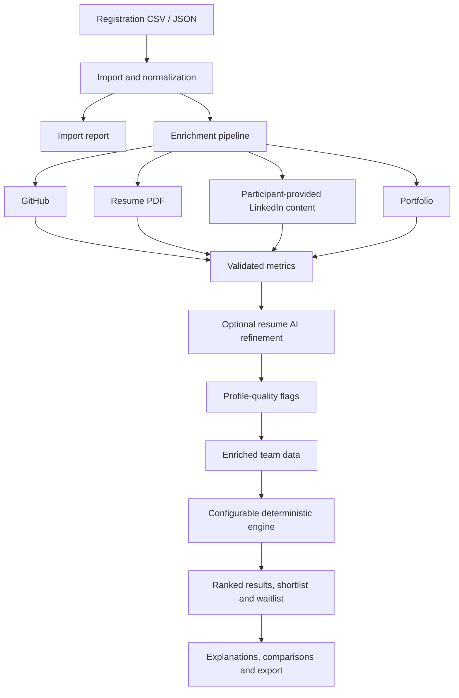

<div align="center">

# 🔭 TeamLens

### Automated Team Recruiter & Explainable Shortlisting

> *Evidence over assumptions. Explainability over black boxes. Human review over automated verdicts.*

---


</div>

---

## 🧠 What is TeamLens?

**TeamLens** is an open-source, evidence-based team evaluation system designed for hackathon organisers and programme coordinators. It ingests team registrations, enriches each member's profile automatically via GitHub, LinkedIn PDFs, resume PDFs, and portfolio sites, then scores and ranks teams using a fully transparent, configurable weighted formula — **with zero opaque AI verdicts.**

Every decision is traceable. Every score is explained. Every human organiser stays in control.

---

## ✨ Feature Highlights

| Feature | Description |
|---|---|
| 📥 **CSV Import** | Import team registrations with configurable column mapping and real-time validation |
| 🔍 **4-Phase Enrichment** | Auto-enriches GitHub → LinkedIn PDF → Resume PDF → Portfolio per member |
| 🧮 **Transparent Scoring** | Weighted formula across 20+ signals; all weights configurable per preset |
| 📊 **Explainability** | Per-metric contribution breakdown, confidence bands, and override audit trail |
| 🙈 **Blind Mode** | One toggle hides all names/photos — evaluators see only signal, not identity |
| ⚖️ **Team Comparison** | Side-by-side comparison of any two teams (shortlisted, waitlisted, or rejected) |
| 🎯 **Sensitivity Analysis** | Visualise how rank changes as any individual weight shifts |
| 🏷️ **Override System** | Pin, waitlist, or exclude teams manually with a mandatory reason; all stored in audit log |
| 📤 **Export** | Download final shortlist with scores, flags, and organiser notes |
| 🔌 **Works Offline** | Client-side fallback mode — full scoring in-browser without a server |

---

## 🗺️ How It Works



### 6-Step Pipeline

1. **Import** — Upload a CSV; TeamLens validates rows, surfaces missing-column warnings, and previews raw data.
2. **Enrich** — Collect supported GitHub, resume, LinkedIn, and portfolio information.
3. **Refine** — Optionally use AI to refine uncertain resume extraction; validate output and retain uncertainty.
4. **Flag** — Produce structured profile-quality signals for human review.
5. **Evaluate** — Apply eligibility filters, score eligible teams, rank results, and apply configured overrides.
6. **Review** — Inspect explanations, compare teams, analyse sensitivity, and export results.

The backend does not make recruitment decisions on its own. The scoring engine uses explicit configuration, and organisers remain responsible for reviewing evidence and making final decisions.

---

## 🏗️ Architecture

TeamLens is a **monorepo** with three fully independent packages:

| Package | Runtime | Role |
|---|---|---|
| `engine/` | Pure JS (Node 22+) | Deterministic scoring library; zero I/O, zero network, fully testable |
| `server/` | Express 5 + Node 22+ | Enrichment API, SQLite cache, PDF parsers, GitHub/Portfolio fetchers |
| `web/` | React 19 + Vite 5 | SPA — imports, scoring UI, comparison, sensitivity analysis, export |

> **Client-Side Fallback:** When the enrichment server is unavailable, `web` loads the engine directly inside a **Web Worker** and scores teams entirely in-browser from manually supplied data. Zero server dependency for the core shortlisting workflow.

---

## 🛠️ Tech Stack

| Layer | Technology |
|---|---|
| **Frontend** | React 19, Vite 5, Zustand, TanStack Query, Tailwind CSS v4 |
| **UI Components** | Radix UI primitives, Lucide icons |
| **Scoring Engine** | Vanilla ES Modules — no framework, no runtime deps |
| **Server** | Express 5, Node 22 built-in SQLite, Multer |
| **PDF Parsing** | pdf-parse, pdf.js |
| **GitHub Enrichment** | Octokit REST |
| **LLM (Optional)** | Google Gemini API / Ollama (resume extraction only; never for ranking) |
| **Testing** | Vitest — 76 engine + 51 web + 35 server = **162 tests** |
| **Linting** | ESLint 9, Prettier |

---

## 🚀 Getting Started

### ⚡ TL;DR Quick Start

```bash
git clone https://github.com/your-org/teamlens.git && cd teamlens
cp .env.example .env          # fill in GITHUB_TOKEN (minimum requirement)
npm install                   # installs all workspaces
npm run dev                   # starts server (:3001) + web (:5173) concurrently
```

Then open **http://localhost:5173** in your browser.

---

### Prerequisites

| Requirement | Minimum Version | Notes |
|---|---|---|
| **Node.js** | 22.13.0 | Built-in SQLite required |
| **npm** | 10+ | Workspaces support |
| **Git** | any | For cloning |

### Detailed Setup

**1. Clone the repository**
```bash
git clone https://github.com/your-org/teamlens.git
cd teamlens
```

**2. Install all dependencies**
```bash
npm install
```
This installs dependencies for all three workspaces (`engine`, `server`, `web`) in one command.

**3. Configure environment variables**
```bash
cp .env.example .env
```
Edit `.env` — at minimum, set your `GITHUB_TOKEN`. See [Environment Configuration](#%EF%B8%8F-environment-configuration) below.

**4. Start the development servers**
```bash
npm run dev
```
This concurrently starts:
- **Enrichment server** on `http://localhost:3001`
- **Web dev server** on `http://localhost:5173`

**5. Build for production**
```bash
npm run build          # builds web/ to web/dist/
npm run start          # serves built web/ and starts server in production mode
```

---

## ⚙️ Environment Configuration

Create a `.env` file at the repository root. Copy `.env.example` as a starting point.

| Variable | Required | Default | Description |
|---|---|---|---|
| `GITHUB_TOKEN` | ✅ Yes | — | Personal Access Token with `public_repo` scope. Without this, GitHub enrichment is skipped for all members. |
| `GEMINI_API_KEY` | Optional | — | Google Gemini API key. Used **only** for resume skill extraction. Set to `none` to disable. |
| `OLLAMA_BASE_URL` | Optional | — | Ollama local endpoint (e.g., `http://localhost:11434`). Alternative to Gemini for offline LLM extraction. |
| `PORT` | Optional | `3001` | Port the enrichment server listens on. |
| `CACHE_TTL_HOURS` | Optional | `24` | How long enrichment results are cached in SQLite before re-fetching. |
| `LOG_LEVEL` | Optional | `info` | Server log verbosity: `debug`, `info`, `warn`, `error`. |

> **Note on LLMs:** TeamLens never uses an LLM for scoring or ranking. LLMs are used solely as an optional extraction layer for structured data from unstructured resume PDFs. The scoring engine is always deterministic.

---

## 📖 Using the Application

### Step 1 — Import Teams

1. Navigate to the **Import** tab.
2. Upload your registration CSV (or paste it directly).
3. TeamLens validates the file and surfaces any column-mapping warnings or missing fields in an **Import Report**.
4. Review warnings (e.g., `LINKEDIN_FILE_IN_URL_COLUMN`) and correct your CSV if needed.

### Step 2 — Map Columns

If your CSV headers differ from TeamLens defaults, the **Column Mapper** lets you drag-and-drop to assign:
- `team_name`, `member_name`, `github_url`, `linkedin_pdf_url`, `resume_url`, `portfolio_url`

### Step 3 — Configure a Preset

Open **Settings → Presets** to define metric weights. Presets are saved to localStorage under the key `teamlens-presets`. You can:
- Adjust weight sliders per metric (0–100, normalised to sum = 1)
- Toggle individual metrics on/off
- Save named presets and switch between them per session

### Step 4 — Run Enrichment

Click **Enrich All Teams**. TeamLens runs the four-phase pipeline for each member in parallel, displaying live progress. Results are cached in SQLite — re-enriching a member whose cache is fresh returns instantly.

### Step 5 — Review & Override

- Browse ranked teams in **Shortlisted / Waitlisted / Rejected** tabs
- Click any team to open the **detail drawer** — view per-metric scores, confidence, contributing signals, and the raw enrichment data
- Use **Blind Mode** (toggle in top bar) to hide names and photos
- Apply overrides: **Pin** (force shortlisted), **Waitlist**, or **Exclude** — each requires a typed reason which is recorded in the audit log
- **Compare** any two teams via the ⚖️ button — a side-by-side hierarchical breakdown appears

### Step 6 — Export

Click **Export Results** to download a CSV with:
- Team name, tier, total score, per-metric scores, flags, confidence bands, and organiser notes

---

## 📡 API Reference

The enrichment server exposes a REST API on `http://localhost:3001`.

### Health & Metadata

```http
GET /api/health
```
Returns server status, version, and cache stats.

```http
GET /api/registry
```
Returns the canonical list of supported enrichment metrics and their metadata. The web UI builds the LinkedIn metric list from this endpoint. Currently returns **5 LinkedIn metrics**: `text`, `experience_count`, `certification_count`, `endorsement_count`, `skills`. (`linkedin.post_count_1y` is reserved and never returned.)

### Enrichment

```http
POST /api/enrich
Content-Type: application/json

{
  "member": {
    "name": "Jane Doe",
    "github_url": "https://github.com/janedoe",
    "linkedin_pdf_url": "https://drive.google.com/uc?export=download&id=FILE_ID",
    "resume_url": "https://drive.google.com/uc?export=download&id=FILE_ID",
    "portfolio_url": "https://janedoe.dev"
  }
}
```

Response:
```json
{
  "ok": true,
  "member": "Jane Doe",
  "enrichment": {
    "github": { "repos": 42, "stars": 310, "commits_1y": 847, "languages": ["TypeScript", "Python"] },
    "linkedin": { "experience_count": 3, "skills": ["React", "Node.js", "SQL"], "certification_count": 2 },
    "resume": { "experience_years": 2.5, "skills_count": 18, "education": "B.Tech CS" },
    "portfolio": { "live": true, "projects_detected": 4 }
  },
  "cached": false
}
```

### Import Validation

```http
POST /api/import/validate
Content-Type: multipart/form-data

file: <CSV file>
```

Returns parsed rows, detected column names, mapping suggestions, and any import warnings (e.g., `LINKEDIN_FILE_IN_URL_COLUMN`).

### Scoring

```http
POST /api/score
Content-Type: application/json

{
  "teams": [ ... ],
  "preset": { "github_score": 0.30, "linkedin_score": 0.25, "resume_score": 0.25, "portfolio_score": 0.20 }
}
```

---

## 📄 Input Data Format

### CSV Column Reference

| Column | Required | Description |
|---|---|---|
| `team_name` | ✅ | Unique team identifier |
| `member_name` | ✅ | Full name of the team member |
| `github_url` | ✅ | GitHub profile URL (e.g., `https://github.com/username`) |
| `linkedin_pdf_url` | ✅ | **Google Drive download link** to the LinkedIn PDF export. Must be shared as "Anyone with the link". |
| `linkedin_url` | Optional | Real LinkedIn profile URL (display only; never scraped) |
| `resume_url` | Optional | Google Drive download link to resume PDF |
| `portfolio_url` | Optional | Portfolio or personal site URL |
| `email` | Optional | Contact email — stored, not enriched |

### LinkedIn PDF Requirements

TeamLens **never scrapes LinkedIn**. Organisers must ask applicants to:

1. Export their LinkedIn profile as a PDF via **LinkedIn → Me → Settings & Privacy → Data Privacy → Get a copy of your data**
2. Upload it to Google Drive and share as **"Anyone with the link"**
3. Paste the Drive link in the `linkedin_pdf_url` column

The PDF must follow LinkedIn's standard export layout — sections: **Contact, Top Skills, Summary, Experience, Education, Certifications**. Experience roles should use date ranges (e.g., `June 2025 – August 2025`), and skills should be listed one per line.

> **Import Warning:** If a Drive file link is found in `linkedin_url` instead of `linkedin_pdf_url`, the importer still picks it up but surfaces a `LINKEDIN_FILE_IN_URL_COLUMN` warning in the Import Report. Always use `linkedin_pdf_url` for the file link.

---

## 📐 Metric & Result Contracts

### Enriched Member Shape

```typescript
{
  name: string;
  github: {
    username: string;
    repos: number;
    stars: number;
    commits_1y: number;
    top_languages: string[];
    contribution_score: number;      // normalised 0–1
  };
  linkedin: {
    experience_count: number;         // distinct roles
    skills: string[];                 // one per line from PDF
    certification_count: number;
    endorsement_count: number;
    text: string;                     // raw extracted text
  };
  resume: {
    experience_years: number;
    skills_count: number;
    education: string;
    projects_count: number;
  };
  portfolio: {
    live: boolean;
    projects_detected: number;
    tech_signals: string[];
  };
}
```

### Team Result Shape

```typescript
{
  team_name: string;
  members: EnrichedMember[];
  score: number;                      // 0–100, weighted aggregate
  tier: "shortlisted" | "waitlisted" | "rejected";
  confidence: "high" | "medium" | "low";
  flags: string[];                    // e.g. ["MISSING_GITHUB", "LOW_LINKEDIN_DATA"]
  metric_breakdown: {
    [metric: string]: {
      raw: number;
      normalised: number;
      weight: number;
      contribution: number;           // weight × normalised
    }
  };
  override?: {
    action: "pin" | "waitlist" | "exclude";
    reason: string;
    timestamp: string;
    operator: string;
  };
}
```

---

## 🧮 Scoring & Explainability

### Weighted Formula

$$\text{TeamScore} = \sum_{i} w_i \cdot \text{norm}(m_i)$$

Where:
- $w_i$ = weight for metric $i$ (configured per preset, sum-normalised to 1)
- $\text{norm}(m_i)$ = signal value normalised to **[0, 1]** using min-max scaling across the current import session

### Metric Normalisation

| Signal | Raw Source | Normalisation |
|---|---|---|
| `github_commits_1y` | Octokit commits API | Min-max across import |
| `github_stars` | Octokit repo stars | Min-max, log-scaled |
| `github_repos` | Octokit repos | Min-max |
| `linkedin_experience_count` | PDF extraction | Min-max |
| `linkedin_skills` | PDF extraction | Count, min-max |
| `linkedin_certifications` | PDF extraction | Count, min-max |
| `resume_experience_years` | LLM / heuristic | Min-max |
| `resume_skills_count` | LLM / heuristic | Min-max |
| `portfolio_live` | HTTP check | Boolean → 0 or 1 |
| `portfolio_projects` | DOM analysis | Count, min-max |

### Explainability Outputs

Every team result includes:
- **Per-metric contribution** (`weight × normalised_value`) shown in the detail drawer
- **Confidence band** based on data completeness (how many fields were enriched vs. missing)
- **Flag list** — machine-readable reasons for low scores or missing data
- **Override audit trail** — full record of any human overrides with timestamp and reason

---

## 🔒 Security & Privacy

| Concern | TeamLens Approach |
|---|---|
| **LinkedIn scraping** | Strictly prohibited. Only PDF files supplied by applicants are processed. |
| **GitHub tokens** | Stored in `.env`; never exposed to the browser or logged |
| **LLM data** | Resume text sent to Gemini/Ollama only when explicitly configured. Can be disabled entirely. |
| **Blind Mode** | Names and avatars hidden in-browser; underlying data unaffected |
| **Local-first** | All enrichment results cached locally in SQLite; no external database |
| **Override accountability** | All manual overrides require a typed reason and are timestamped |

---

## 🧪 Testing

Run the full test suite across all workspaces:

```bash
npm test                    # all 162 tests
```

Or target individual packages:

```bash
npm test --workspace=engine    # 76 tests — scoring, normalisation, edge cases
npm test --workspace=web       # 51 tests — components, stores, worker
npm test --workspace=server    # 35 tests — enrichment pipeline, API routes
```

Watch mode for active development:

```bash
npm run test:watch --workspace=engine
```

Generate a coverage report:

```bash
npm run test:coverage
```

### Test Summary

| Package | Tests | Coverage Areas |
|---|---|---|
| `engine` | **76** | Weighted formula, normalisation, sensitivity, edge-case data |
| `web` | **51** | React components, Zustand stores, Web Worker bridge |
| `server` | **35** | Enrichment routes, PDF parsers, GitHub fetcher, cache TTL |
| **Total** | **162** | |

---

## ⚠️ Known Limitations

| Limitation | Detail |
|---|---|
| **Google Drive links only** | LinkedIn and resume PDFs must be hosted on Google Drive with public share. Direct upload support is planned. |
| **LinkedIn PDF format variance** | Older LinkedIn PDF exports may not match the expected section layout, reducing extraction accuracy. |
| **GitHub rate limits** | The GitHub API allows 5,000 requests/hour per token. Large imports (50+ members) may hit rate limits. |
| **LLM extraction accuracy** | Resume skill extraction via LLM is best-effort; structured sections extract with higher confidence than freeform text. |
| **No persistent user auth** | TeamLens has no login system — it's a single-session tool for organisers. Multi-user support is not planned. |
| **English only** | PDF extraction and heuristics are tuned for English-language documents. |

---

## 📁 Repository Structure

```
teamlens/
├── engine/                     # Pure-JS scoring library
│   ├── src/
│   │   ├── score.js            # Core weighted formula
│   │   ├── normalise.js        # Min-max normalisation
│   │   ├── sensitivity.js      # Sensitivity analysis engine
│   │   └── compare.js          # Pairwise team comparison
│   ├── tests/                  # 76 unit tests
│   └── package.json
│
├── server/                     # Express 5 enrichment API
│   ├── src/
│   │   ├── routes/             # /api/enrich, /api/score, /api/import, /api/registry
│   │   ├── enrichers/
│   │   │   ├── github.js       # Octokit-based GitHub enricher
│   │   │   ├── linkedin.js     # PDF text extraction + parsing
│   │   │   ├── resume.js       # PDF parsing + optional LLM extraction
│   │   │   └── portfolio.js    # HTTP + DOM analysis
│   │   ├── cache.js            # SQLite cache (Node 22 built-in)
│   │   └── app.js              # Express app factory
│   ├── tests/                  # 35 integration tests
│   └── package.json
│
├── web/                        # React 19 SPA
│   ├── src/
│   │   ├── components/         # Layout, Import, EnrichmentPanel, TeamCard,
│   │   │                       #   CompareDrawer, SensitivityChart, ...
│   │   ├── stores/             # Zustand stores (teams, presets, overrides)
│   │   ├── workers/            # Web Worker for client-side scoring
│   │   ├── hooks/              # Custom React hooks
│   │   └── index.css           # Tailwind v4 + TeamLens palette
│   ├── tests/                  # 51 component + store tests
│   └── package.json
│
├── .env.example                # Environment variable template
├── package.json                # Root workspace config
└── README.md                   # This file
```

---

## 🤝 Contributing

Contributions are welcome! Please read through these guidelines before opening a PR.

### Development Workflow

```bash
# 1. Fork and clone
git clone https://github.com/your-org/teamlens.git

# 2. Create a feature branch
git checkout -b feature/your-feature-name

# 3. Install dependencies
npm install

# 4. Make your changes; run tests continuously
npm run test:watch --workspace=engine

# 5. Verify all 162 tests pass before opening a PR
npm test

# 6. Lint and format
npm run lint
npm run format

# 7. Open a pull request against main
```

### Contribution Guidelines

- **Engine changes** must include unit tests. The scoring formula must remain deterministic — no randomness.
- **Server changes** must not break any existing API contracts. Add tests for new routes.
- **UI changes** must not regress the blind mode, override audit log, or comparison view.
- **Do not add LLM calls to the scoring path.** LLMs are permitted only in the resume enricher.
- Keep commits small and scoped. PR titles should follow: `feat: ...`, `fix: ...`, `docs: ...`, `test: ...`.

---

## 📜 License

MIT © TeamLens Contributors

---

<div align="center">

**TeamLens** — built to help organisers make more consistent, explainable, and human-led shortlisting decisions.

*Evidence over assumptions. Explainability over black boxes. Human review over automated verdicts.*

</div>
