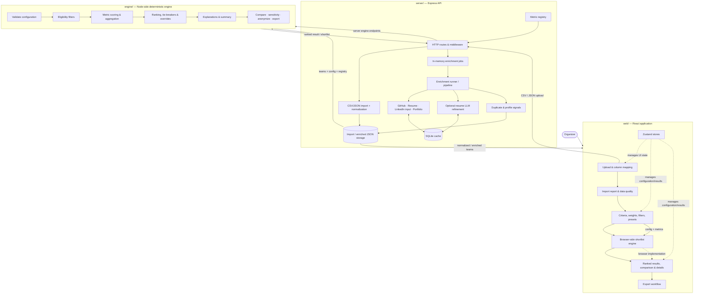
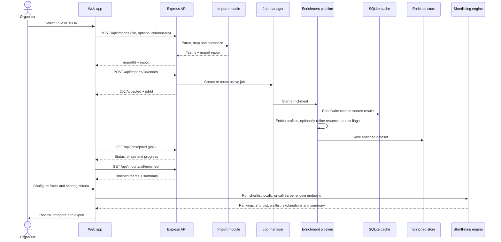
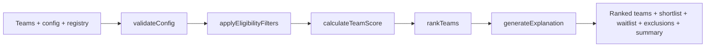
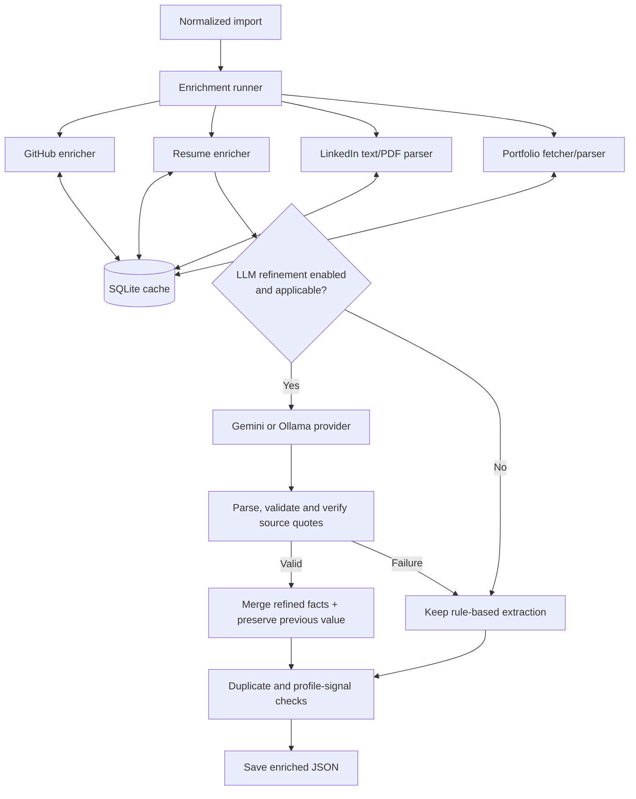

# System Architecture — TeamLens

> **Purpose:** document how the repository is structured, how registration data becomes an explainable shortlist, and where the important contracts and trust boundaries live.

## 1. At a glance

**TeamLens** is a configurable team-selection and recruitment workflow for hackathons and similar events. It turns registration data into profile evidence, applies organizer-defined eligibility and scoring rules, and presents a shortlist with reasons and supporting details.

The system separates three concerns:

- **Collect evidence** — import and normalize registration data, enrich participant profiles, and surface data-quality or profile-integrity signals.
- **Make decisions transparently** — apply explicit filters, metric aggregation, normalization, weights, missing-data policies, tie-breakers, and manual overrides.
- **Help organizers review outcomes** — configure a run, inspect team-level results, compare teams, review explanations, and export the result.

The key trust boundary is deliberate: **AI can help extract structured facts; it does not decide who gets selected.** Ranking is performed by deterministic, configuration-driven engine code. Profile flags are signals for human review, not automatic findings of fraud.

### Main technologies

| Area | Technologies visible in the repository |
|---|---|
| Web application | React 19, Vite, React Router, Zustand, TanStack Table, Recharts, Tailwind CSS |
| Server | Node.js, Express 5, Multer, Papa Parse, `p-limit`, Zod |
| Enrichment | GitHub API integration, `cheerio`, `unpdf`, rule-based parsers, optional Gemini or local Ollama |
| Cache | Node's built-in `node:sqlite` with a local SQLite database |
| Engine | ES modules and pure JavaScript modules; Vitest tests |
| Validation and tests | Zod contracts, Vitest, Supertest, registry and enriched-output validation scripts |

## 2. System architecture



**Important implementation detail:** the repository currently contains both `engine/src/` and a browser-oriented implementation under `web/src/engine/`. The server imports the Node-side engine from `engine/src/index.js`; the web app has its own shortlist implementation and Web Worker. Treat these as two execution paths that must remain behaviorally aligned—not as one already-shared engine bundle.

## 3. Repository map

```text
Incursion_2k26/
├── config.js                       # Shared Zod configuration contract
├── metrics.registry.json           # Root metric registry copy
├── shared-samples/                 # Example config, feedback, CSV and enriched data
├── engine/
│   ├── src/
│   │   ├── comparison/             # Team-to-team comparison
│   │   ├── config/                 # Config validation and presets
│   │   ├── explain/                # Explanation generation
│   │   ├── export/                 # Shortlist export
│   │   ├── filters/                # Eligibility filtering
│   │   ├── scoring/                # Normalization, aggregation, scoring, ranking
│   │   ├── sensitivity/            # Sensitivity analysis
│   │   ├── utils/                  # Blind-mode anonymization
│   │   └── index.js                # Public engine entry point
│   └── tests/                      # Unit and integration-style engine tests
├── server/
│   ├── src/
│   │   ├── config/                 # Environment configuration
│   │   ├── contracts/              # Backend metric registry
│   │   ├── middleware/             # Not-found and error handling
│   │   ├── modules/
│   │   │   ├── cache/              # SQLite cache
│   │   │   ├── enrich/             # Pipeline, runner, stores and enrichers
│   │   │   ├── flags/              # Duplicate checks and profile signals
│   │   │   ├── import/             # CSV/JSON parsing and normalization
│   │   │   ├── jobs/               # In-memory job lifecycle and progress
│   │   │   ├── llm/                # Provider adapters, redaction and extraction
│   │   │   └── metrics/            # Registry access and metric values
│   │   ├── routes/                 # HTTP API endpoints
│   │   ├── utils/                  # HTTP error helpers
│   │   ├── app.js                  # Express application composition
│   │   └── index.js                # Server entry point
│   ├── scripts/                    # Registry and enriched-file checks
│   ├── samples/                    # Focused sample datasets
│   └── tests/                      # API, import, enrichment and provider tests
├── web/
│   ├── src/
│   │   ├── components/             # Upload, configuration, results and UI components
│   │   ├── engine/                 # Browser-side scoring + Web Worker
│   │   ├── lib/                    # API client, client import, schema, export helpers
│   │   ├── pages/                  # Upload, configuration, results, export
│   │   ├── stores/                 # Zustand state stores
│   │   ├── App.jsx                 # App routes / composition
│   │   └── main.jsx                # Browser entry point
│   └── tests/                      # UI, import, scoring, export and scale-oriented tests
└── tests/
    └── integration/                # Cross-module import pipeline tests
```

### Module ownership

| Module | Responsibility | Should not own |
|---|---|---|
| `web/` | Organizer interaction, local import fallback, configuration editing, results review, UI state | Secrets, server-side profile fetching, authoritative enrichment cache |
| `server/src/modules/import/` | Parse CSV/JSON, map headers, normalize rows, group members into teams, report issues | Ranking policy |
| `server/src/modules/enrich/` | Gather profile facts and attach metric values with provenance/status | Shortlisting or rejection decisions |
| `server/src/modules/flags/` | Detect duplicate submissions and profile patterns worth reviewing | Final judgments about a participant |
| `server/src/modules/llm/` | Optional structured extraction with provider handling, redaction, validation and cache | Metric weights, eligibility decisions or ranking |
| `engine/src/` | Validate scoring configuration and compute filters, scores, ranking and explanations | Network calls, profile scraping or AI inference |
| Metric registry copies | Define metric identifiers and metadata used across modules | Runtime business logic |

## 4. End-to-end data flow



### Stage-by-stage

1. **Import:** the organizer supplies CSV or JSON. CSV headers can be mapped; input is normalized into teams and members. The import report records skipped rows, issues, team sizes, and source coverage.
2. **Enrichment:** source enrichers gather available GitHub, resume, participant-provided LinkedIn, and portfolio evidence. Work is concurrency-limited and reuses cache entries where applicable.
3. **Refinement:** when enabled and useful, the LLM can refine uncertain resume extraction. Its output is parsed and schema-validated; returned facts require a matching verbatim source quote. Failed refinement leaves rule-based values in place and can raise a flag.
4. **Integrity signals:** duplicate URLs, similar resumes, and profile-pattern checks attach flags separately from metric scores.
5. **Persistence:** the enriched result is saved as JSON. The current job status/progress is held in memory.
6. **Shortlisting:** the organizer chooses a configuration. The engine validates it, filters teams, scores eligible teams, ranks them, applies tie-breakers/overrides, and produces explanations and summary counts.
7. **Review and export:** the UI supports ranked results, team comparison/details, and export-oriented workflows.

## 5. Web application

The UI is organized around the organizer's workflow.

| Location | Role |
|---|---|
| `web/src/pages/UploadPage.jsx` | Upload CSV/JSON, map headers, show import report and data-quality status, trigger enrichment, poll job progress |
| `web/src/pages/ConfigPage.jsx` | Edit selection capacity, criteria, weights, filters, presets and blind-mode settings; initiate re-ranking |
| `web/src/pages/ResultsPage.jsx` | Review ranked outcomes and inspect team-level details |
| `web/src/pages/ExportPage.jsx` | Prepare/download shortlist output |
| `web/src/components/upload/` | Column mapping, import report, data-quality dashboard |
| `web/src/components/config/` | Criteria editor, filter editor, selection panel and preset manager |
| `web/src/components/results/` | Results table, team comparison modal and team detail drawer |
| `web/src/stores/` | Zustand stores for import, config, presets and results |
| `web/src/lib/api.js` | HTTP client for backend endpoints |
| `web/src/lib/clientImport.js` | Browser-side CSV/JSON parsing and fallback enrichment |
| `web/src/engine/worker.js` | Runs the browser-side shortlist implementation in a Web Worker |

### Client-side fallback

`UploadPage` attempts the backend first. If the server is unavailable, the UI can parse the input and run a limited browser-side path. The interface identifies this as client-side mode. This fallback is useful for resilience and demos, but it should not be assumed to provide the same source coverage as the server enrichment pipeline.

The web app uses a worker for responsive local re-ranking, while `server/src/routes/engine.routes.js` also exposes engine operations. That dual path is useful, but it creates a **parity obligation**: changes to scoring, missing-data behavior, filters, tie-breakers, overrides or explanation logic should be tested against both paths.

## 6. Deterministic shortlisting engine

The Node-side engine's public entry point is `engine/src/index.js`, which exports `runEngine` plus supporting features such as comparison, sensitivity analysis, presets, export and anonymization.



### Core pipeline

1. **Validate configuration** against supported metrics and configuration constraints.
2. **Apply eligibility filters** and separate rejected/review teams from eligible teams.
3. **Calculate team scores** by evaluating configured criteria and metric values.
4. **Rank and select** using selection capacity, configured tie-breakers and manual overrides.
5. **Generate explanations** so the outcome can be inspected rather than presented as an opaque score.
6. **Return structured results**, including ranked teams, shortlist, waitlist, excluded teams, rejected teams, review teams and summary counts.

### Scoring concepts

The root `config.js` Zod contract describes the intended configuration vocabulary:

- **Criteria:** metric identifier, weight, enabled state, normalization, member-to-team aggregation, size normalization, and missing-value policy.
- **Normalization:** none, min-max, percentile, or cap-based.
- **Aggregation:** max, mean, median, sum, or top-two mean.
- **Missing values:** reweight the remaining criteria, score as zero while still reporting missingness, or use a configured neutral value.
- **Eligibility filters:** operators such as comparisons, existence and containment; scope can be any member, all members, at least N members, or the team; missing data can fail, pass or trigger review.
- **Selection controls:** shortlist size, waitlist size, tie-breakers, pin/exclude/waitlist overrides, a reproducibility seed and blind mode.

**Contract caution:** the repository includes multiple config/engine implementations and the planning materials describe some configuration options that are not necessarily identical across all current code paths. Validate the exact schema and behavior used by the chosen entry point before assuming every option in `config.js` is supported identically by both engines.

### Engine features beyond ranking

- `engine/src/comparison/compareTeams.js` — compare teams.
- `engine/src/sensitivity/analyzeSensitivity.js` — analyze how ranking changes when configuration is varied.
- `engine/src/explain/generateExplanation.js` — attach criterion-level explanations/reason data.
- `engine/src/export/exportShortlist.js` — produce shortlist export data.
- `engine/src/utils/anonymizeTeams.js` — support anonymized/blind review data.
- `engine/src/config/presets.js` — provide scoring presets.

## 7. Enrichment backend

The backend is an Express application assembled in `server/src/app.js`. Route handlers delegate to modules rather than implementing the whole workflow in HTTP handlers.

### Enrichment pipeline



### Backend module map

| Path | Responsibility |
|---|---|
| `server/src/app.js`, `server/src/index.js` | Express setup, middleware, route mounting and server startup |
| `server/src/routes/` | Health, import, registry, job, enrichment and engine HTTP endpoints |
| `server/src/config/env.js` | Environment configuration and defaults |
| `server/src/modules/import/` | CSV/JSON parsing, header mapping, normalization, duplicate-email checks and import report |
| `server/src/modules/enrich/runner.js` | Run enrichers across teams with progress/concurrency controls |
| `server/src/modules/enrich/pipeline.js` | Orchestrate enrichment, flags, progress phases and output persistence |
| `server/src/modules/enrich/enrichers/github/` | GitHub URL parsing, client, API metrics and cache-aware retrieval |
| `server/src/modules/enrich/enrichers/resume/` | PDF retrieval, text extraction, section parsing, experience and resume metrics |
| `server/src/modules/enrich/enrichers/linkedin/` | Parse participant-provided LinkedIn text/PDF content |
| `server/src/modules/enrich/enrichers/portfolio/` | Safe fetching, HTML parsing and technology/content signals |
| `server/src/modules/enrich/refiners/resumeLlm.js` | LLM-assisted resume refinement |
| `server/src/modules/llm/` | Provider selection, Gemini/Ollama adapters, redaction, throttling, cache and schema validation |
| `server/src/modules/flags/` | Duplicate URL/resume detection, profile signals and centralized thresholds |
| `server/src/modules/metrics/` | Metric value representation and registry access |
| `server/src/modules/cache/sqliteCache.js` | Persistent local cache backed by Node's `node:sqlite` |
| `server/src/modules/jobs/jobs.js` | In-memory job state, active-job reuse, progress and completion status |
| `server/src/modules/import/store.js`, `server/src/modules/enrich/store.js` | Import and enriched-result persistence |
| `server/scripts/registry-check.js` | Check registry metric/provider coverage |
| `server/scripts/validate-enriched.js` | Validate enriched output against the expected contract |

### Enrichment source behavior

- **GitHub:** uses the configured GitHub API integration for activity and repository metrics. Without a token, the notes describe a mock-data fallback marked with a `mock` origin so simulated values are not mistaken for live evidence.
- **Resume:** extracts text from PDFs and derives structured values using rule-based parsing. Scanned PDFs requiring OCR and Word documents are outside the documented support boundary.
- **LinkedIn:** does **not** scrape LinkedIn profiles. It analyzes text supplied by the participant or a LinkedIn-generated PDF.
- **Portfolio:** fetches and parses accessible pages. Browser-rendered single-page applications may expose little usable content and can produce low-confidence results.
- **LLM refinement:** optional and focused on uncertain resume extraction. Rule-based values remain the fallback.

## 8. Data contracts and provenance

### Shared metric registry

The metric registry is the contract connecting data production to scoring and presentation. Registry copies exist at the repository root, `server/src/contracts/metrics.registry.json`, and `shared-samples/metrics.registry.json`. Keep these aligned when metric definitions change.

The backend notes describe a registry of **32 metric IDs: 31 delivered and one deliberately reserved**. A metric should be added with a clear identifier, source/provider, type/meaning and the metadata required by downstream consumers. The `registry:check` script is intended to detect metrics without providers.

### Metric status semantics

The enrichment notes define four statuses:

| Status | Meaning |
|---|---|
| `ok` | A value was extracted or fetched successfully |
| `not_provided` | The participant did not provide the relevant source/input |
| `fetch_failed` | A source was supplied, but could not be read; preserve a reason |
| `low_confidence` | A value was extracted, but the evidence is uncertain |

These statuses are intentionally different. **Missing evidence must not silently become a zero.** A numeric value without provenance or status can be misleading, so downstream scoring and UI code should preserve and display the distinction.

The shared metric value shape is conceptually:

```json
{
  "value": 3,
  "status": "ok",
  "origin": "github",
  "confidence": 0.94
}
```

The exact optional fields depend on the metric and the contract version; the example is illustrative rather than a complete schema.

### Team/member shape

Registration input is normalized into teams containing members. The import layer groups rows by `team_id`; member-level source fields include resume, GitHub, LinkedIn and portfolio inputs. Extra CSV columns are retained for rule/config use rather than discarded, allowing organizers to define filters against registration-specific fields.

Enriched output adds metric evidence and flags without overwriting the raw import. The enrichment pipeline clones the imported teams before mutation, and the saved enriched result includes metadata such as `asOf`, `enrichedAt`, enrichers and a summary.

### AI extraction controls

The supplied backend notes specify these controls:

- Rule-based parsing runs first; AI is a narrow refinement step.
- Email addresses and phone numbers are redacted before AI calls.
- The model is asked for structured output; JSON is parsed and validated against a schema.
- Extracted facts must include a verbatim quote from the source; quotes are checked before accepting the facts.
- Calls are throttled and results cached; temperature/model configuration is intended to support reproducibility.
- If the AI step fails, the rule-based value is retained and the failure is surfaced rather than silently replacing evidence.
- When an AI value replaces a rule-based value, the earlier value is retained in `previous`; the AI model and run date are recorded.

## 9. API surface

The following endpoints are mounted in the current server source. Request/response details can evolve; route handlers and tests are the definitive reference.

| Method | Endpoint | Purpose |
|---|---|---|
| `GET` | `/api/health` | Health check |
| `POST` | `/api/imports` | Import CSV or JSON; accepts multipart `file` and optional CSV `columnMap` |
| `GET` | `/api/imports/:id` | Retrieve normalized import data and its report |
| `POST` | `/api/imports/:id/enrich` | Start enrichment; normally returns `202` with a job descriptor |
| `POST` | `/api/imports/:id/enrich?wait=true` | Run enrichment synchronously for scripts/tests |
| `GET` | `/api/jobs/:jobId` | Poll job status, phase, progress and completion/error details |
| `GET` | `/api/imports/:id/enriched` | Retrieve saved enriched teams and summary |
| `GET` | `/api/registry` | Retrieve metric registry information |
| `POST` | `/api/engine/run` | Run the Node-side engine |
| `POST` | `/api/shortlist` and related subroutes | Shortlist-compatible engine route aliases and supporting operations |

The engine router also exposes operations for presets, comparison, sensitivity analysis, export and anonymization; see `server/src/routes/engine.routes.js` for the exact subpaths and payloads.

### Job lifecycle

An enrichment job progresses through:

`queued → running → done | failed`

While running, the backend reports phases:

`enrich → llm → flags → saving`

The browser polls the job endpoint for updates. Job state is held in a process-local `Map`, so **job progress is not durable across server restarts**. The saved enriched JSON is the durable result for the current design.

## 10. Security, reliability and responsible use

### URL fetching and external APIs

The backend notes describe a server-side URL guard for participant-supplied URLs, including checks against localhost/private addresses, redirect re-validation, size limits and timeouts. These controls matter because fetching user-submitted URLs creates an SSRF risk. Any new fetcher must use the safe-fetch path and preserve these protections.

### Secrets and data handling

- API keys belong in `server/.env`; `.env` is ignored by Git.
- `server/.env.example` documents configuration without embedding credentials.
- GitHub credentials are used server-side, not exposed to the browser.
- Cached resume text can contain personal data. The backend notes explicitly recommend deleting the local `data/` directory after an event.
- LinkedIn profile scraping is out of scope; only participant-supplied text or exported PDFs are analyzed.

### Fairness and human review

- Missingness and confidence should remain visible through the UI and scoring flow.
- Profile flags are evidence for organizers to review, not a verdict or an automatic rejection.
- Eligibility filters and scoring weights are explicit organizer configuration.
- Blind mode and anonymization utilities support review workflows, but their actual effect depends on the selected code path and UI configuration.
- The engine should not infer intent, credibility or merit from a single weak signal. Use multiple evidence sources and inspect the explanation before acting.

## 11. Caching, performance and reproducibility

- **SQLite cache:** source and LLM results can be reused across runs, subject to TTL configuration.
- **Concurrency limits:** enrichment work and AI requests are limited to avoid overloading upstream services and rate limits.
- **Request/job de-duplication:** an active enrichment job for an import can be reused rather than started again.
- **Resume similarity:** the backend notes describe an inverted-index approach rather than comparing every resume pair naively.
- **Reproducibility metadata:** enrichment records an `asOf` timestamp; AI-refined values retain model metadata and prior values. The scoring configuration includes a seed for seeded tie-breaking.
- **No network in the engine:** keep scoring logic deterministic and side-effect-free; source acquisition belongs in the backend.

Performance claims should stay measured. The backend notes explicitly say the server has **not been load-tested beyond small samples**. Avoid claiming production-scale capacity without running and documenting representative benchmarks.

## 12. Testing and validation

The repository contains tests at several levels:

- `engine/tests/` — scoring, normalization, aggregation, filters, ranking, tie-breakers, overrides, explanation, comparison, sensitivity and edge cases.
- `web/tests/` — client import/schema behavior, scoring, UI flows, export and scalability-oriented cases.
- `server/tests/` — API routes, enrichment runner, GitHub metrics/client/cache, resume files/cache, portfolio parsing and LLM validation.
- `tests/integration/` — cross-module import pipeline.
- `server/scripts/registry-check.js` — registry/provider consistency check.
- `server/scripts/validate-enriched.js` — validate an enriched dataset.

Useful package scripts visible in the repository:

```bash
# Backend
cd server
npm install
npm run dev
npm test
npm run registry:check
npm run validate -- <importId>

# Engine
cd engine
npm install
npm test

# Web app
cd web
npm install
npm run dev
npm run build
npm test

# Cross-module integration tests
cd tests
npm install
npm test
```

The backend notes warn that three stale test fixtures needed attention before claiming the entire suite passes. **Do not describe the whole test suite as green unless it has been run against the current checkout and the failures have been resolved.**

## 13. Known limitations and operational notes

These are documented constraints, not bugs to hide:

1. Resume parsing supports PDFs with extractable text; there is no OCR for scanned PDFs and Word documents are unsupported.
2. Google Forms upload URLs must be accessible to the backend, or participants should provide resume text.
3. A LinkedIn URL alone is insufficient; participants must provide text or an exported PDF.
4. JavaScript-rendered portfolio sites may return little content and low-confidence results.
5. `linkedin.post_count_1y` is reserved because the required full LinkedIn export is not collected.
6. GitHub repository-level statistics use the 100 most recently pushed original repositories; total repo counts are exact.
7. Background job state is in memory and is cleared on restart; saved enriched JSON is the durable output.
8. LLM processing can be slow under free-tier rate limits; it is optional.
9. The backend has not been load-tested beyond small samples.
10. The web and Node engine implementations are separate code paths and need parity tests when scoring behavior changes.
11. The repository contains multiple copies of the metric registry/config-related contract material. A change should be propagated deliberately and validated across consumers.

## 14. Architectural decisions and rationale

| Decision | Why it matters |
|---|---|
| Separate enrichment from ranking | External data collection and parsing can fail independently without changing the scoring policy |
| Deterministic, configuration-driven engine | Organizers can explain and reproduce why a team was selected |
| Registry-driven metrics | Keeps metric identifiers consistent between providers, config and downstream consumers |
| Explicit missing-data statuses | Prevents unavailable evidence from silently being treated as a poor score |
| Optional AI extraction | Improves uncertain extraction without making AI a required dependency or decision-maker |
| Quote verification and schema validation | Constrains extraction to evidence actually present in the source |
| Separate flags from score | Makes suspicious patterns visible for review without turning them into automatic verdicts |
| Background enrichment jobs | Allows slow source fetches and optional AI work to run with progress reporting |
| Browser-side ranking worker | Keeps interactive configuration changes responsive |
| Local persistent cache | Reduces repeated requests and supports faster reruns |

## 15. Recommended maintenance rules

When extending the project:

1. **Adding a metric:** update the registry contract, implement its provider, add tests, run `registry:check`, validate sample enriched data, and verify it appears correctly in the UI/configuration.
2. **Adding an enricher:** keep source acquisition in `server/src/modules/enrich/enrichers/`, preserve statuses/origin/confidence, use safe fetching for URLs, and add failure-path tests.
3. **Adding an AI extraction field:** define a schema, redact personal data, require source-grounded evidence, validate output, cache only validated results, and preserve rule-based fallbacks.
4. **Changing scoring behavior:** update Node and browser engine paths together; test missing data, ties, overrides, filters and explanations in both.
5. **Changing config:** check `config.js`, `engine/src/config/validateConfig.js`, web schema/controls, presets, example config and tests for compatibility.
6. **Changing registry data:** keep root, server and shared-sample registry copies aligned until the repository has a single generated/source-of-truth registry.
7. **Making performance claims:** benchmark import, enrichment and ranking separately with documented dataset sizes and environment details.
8. **Handling participant data:** do not commit real resumes, exports, tokens, or cached personal data; remove `data/` after the event as specified by the backend notes.

## 16. Source references

This document is grounded in:

- **Repository source:** `engine/`, `server/`, `web/`, `tests/`, root `config.js` and `metrics.registry.json`, plus `shared-samples/`.
- **Planning:** *Track 3 Team Recruitment Automation Tool Planning Doc* — intended system boundaries, shared contracts, deterministic selection model and proposed workflow.
- **Backend implementation notes:** *Enrichment Backend: Notes for the README* — current enrichment pipeline, statuses, security controls, endpoints, AI constraints, known limitations and operational caveats.

For implementation-level questions, prefer the source code and tests over this overview. This document describes the architecture; it does not replace API schemas, test cases, or the metric registry.
